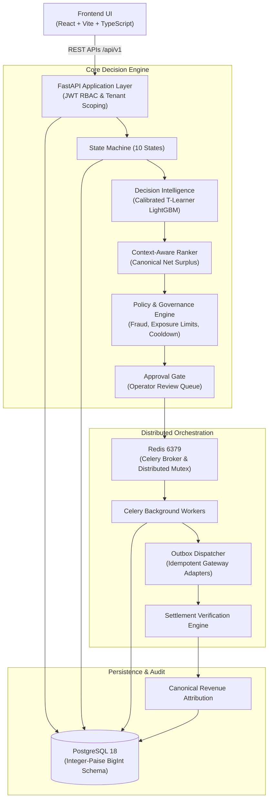
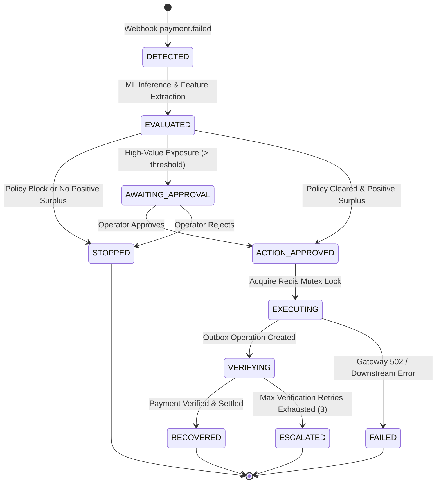

# Averiq — Systems Architecture Specification

---

## 1. High-Level Architecture & Layered Hierarchy

---

## 2. Complete State Machine Lifecycle

---

## 3. Detailed Component Architecture

### 3.1 Decision Intelligence (`backend/ml/`)
- **Action Vocabulary**: `NO_INTERVENTION`, `PAYMENT_LINK`, `RETRY`, `CUSTOMER_ACTION`.
- **Artifact**: `model_artifacts/action_value_v3.pkl` (calibrated action-specific LightGBM regressors).
- **Fallback**: Fallback probability strictly $P_0 = 0.35$ when artifacts are absent.

### 3.2 Canonical Economics (`backend/api/analytics.py`)
- $\text{Gross Recovery} = Y_{\text{selected}} \times \text{Amount}$
- $\text{Organic Recovery} = Y_0 \times \text{Amount}$
- $\text{Incremental Recovery} = (Y_{\text{selected}} - Y_0) \times \text{Amount}$ (unclamped; negative values preserved)
- $\text{Net Incremental Surplus} = \text{Incremental Recovery} - \text{Intervention Cost}$

### 3.3 Storage Layer (`backend/domain/models.py`)
- PostgreSQL 18 with async SQLAlchemy 2.0.
- Check constraints enforce state validity (`chk_cases_state_valid`) and positive amounts (`chk_cases_payment_amount_positive`).
- Monetary values stored strictly as 64-bit integer paise (`BigInteger`).
