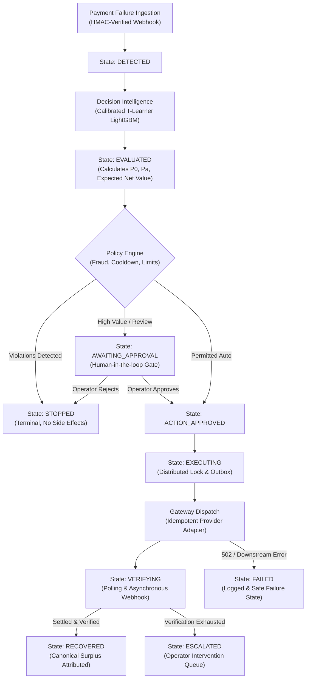

# Averiq — Technical Case Study
**AI Revenue Recovery Decision Engine**
**Hiring-Grade Systems & Decision Intelligence Architecture**

---

## 1. The Core Problem: Why Revenue Recovery is Difficult

Failed digital payments in modern high-volume payment architectures (cards, UPI, recurring subscriptions, mandate debits) cost online merchants 2% to 7% of gross merchandise value annually. Traditional payment systems typically treat payment failures in one of two suboptimal ways:

1. **Blind Retries**: Immediately and repeatedly resubmitting the charge through the same payment rail. While simple, blind retries incur steep acquirer decline penalties, exhaust card brand velocity counters, increase churn, and trigger fraud alarms.
2. **Static Heuristic Rules**: Rigid if/else rules based on raw gateway error strings (e.g., "if `insufficient_funds`, wait 24 hours; if `card_declined`, send email"). These heuristics fail because raw gateway error codes are notoriously uninformative, customer payment contexts differ widely, and static rules ignore **counterfactual recovery economics** (many payments recover organically without any merchant intervention).

---

## 2. Decision Intelligence vs. Raw Prediction

The central architectural innovation in Averiq is the distinction between **prediction** and **decision intelligence**:

- **A prediction model asks**: *"What is the probability that this failed payment will recover?"*
- **A decision engine asks**: *"Given this failed payment, which permitted recovery intervention is expected to produce the greatest incremental recovery value, after accounting for policy guardrails, fraud risk, action friction costs, and human approval limits?"*

### The T-Learner Action-Value Framework
To answer the decision intelligence question, Averiq implements a calibrated **T-Learner** built on action-specific LightGBM models over a four-action discrete decision vocabulary:

$$\mathcal{A} = \{\text{NO\_INTERVENTION}, \text{PAYMENT\_LINK}, \text{RETRY}, \text{CUSTOMER\_ACTION}\}$$

For each failed payment with contextual feature vector $X \in \mathbb{R}^d$, the model estimates action-specific recovery probabilities:

$$\hat{Y}_a(X) = P(\text{Recovered} \mid \text{Action} = a, X) \quad \forall a \in \mathcal{A}$$

### Why `NO_INTERVENTION` is Mandatory
The control arm $a_0 = \text{NO\_INTERVENTION}$ estimates the **organic recovery probability** $P_0 = \hat{Y}_0(X)$. In real-world commerce, a substantial fraction of customers independently notice a decline and complete their purchase organically via another card, web session, or UPI app.

Intervening on a customer who would have recovered anyway generates **zero incremental value** while incurring operational friction, customer annoyance, and gateway transaction fees. Averiq only selects an active intervention when its estimated incremental uplift outweighs its costs.

---

## 3. Canonical Counterfactual Economics (Phase 3.6 Standard)

Averiq implements strict counterfactual economic accounting with zero floating-point arithmetic. All monetary amounts are represented as integer paise (minor units: $1\text{ INR} = 100\text{ paise}$).

For a failed transaction of amount $A$ and selected intervention $a^*$:

$$\text{Gross Recovered Value} = \hat{Y}_{a^*}(X) \times A$$

$$\text{Organic Baseline Value} = \hat{Y}_0(X) \times A$$

$$\text{Incremental Recovered Value} = (\hat{Y}_{a^*}(X) - \hat{Y}_0(X)) \times A$$

$$\text{Net Incremental Surplus} = \text{Incremental Recovered Value} - \text{Cost}(a^*)$$

### Strict Negative Value Preservation
Unlike naive dashboard systems that clamp negative values to zero ($\max(0, \Delta)$), Averiq preserves negative incremental values:

$$\text{If } \hat{Y}_{a^*}(X) < \hat{Y}_0(X), \quad \text{Incremental Value} < 0$$

If an intervention disrupts organic recovery (e.g., an aggressive retry fails and permanently locks a customer's banking session), the model penalizes that intervention and records the negative economic impact honestly.

---

## 4. End-to-End System Pipeline

---

## 5. Architectural Deep Dives

### 5.1 Deterministic Policy Separation
Machine learning models suggest candidate actions based on expected probability, but **policy controls authority**:
- **Fraud Guard**: If fraud signals or high-risk heuristics trigger, non-STOP actions receive a `BLOCK` verdict with reason `fraud_suspected`.
- **Maximum Exposure Gate**: Interventions on payments exceeding `max_amount_paise` (e.g. ₹50,000) are blocked.
- **Merchant Velocity Cooldown**: Prevents sending more than 1 notification or retry burst within 3,600 seconds to the same customer.
- **STOP Action Exemption**: Action `NO_INTERVENTION` is exempt from policy blocks, ensuring the system can always safely transition to `STOPPED`.

### 5.2 Idempotency & Distributed Execution Safety
In distributed payment orchestration, duplicate webhooks and network retries are common. Averiq guarantees exactly-once side effects through a three-layer defense:
1. **Webhook Idempotency Key**: Webhook event payloads are hashed (`provider_event_id` or SHA-256 payload hash). Duplicate events are logged and dropped with `ALREADY_PROCESSED`.
2. **Redis Concurrency Lock**: Prior to executing an intervention outbox task, a worker acquires a Redis mutex `lock:execution:{case_id}` with an explicit TTL. Simultaneous concurrent triggers are blocked.
3. **Database Check Constraints**: PostgreSQL enforce state machine transition validity (`chk_cases_state_valid`) and positive monetary balances (`payment_amount_at_risk > 0`).

### 5.3 CUSTOMER_ACTION as an Internal Action
`CUSTOMER_ACTION` represents advisory messaging within the merchant's portal or customer self-service app (e.g. "Please update your billing card"). Architecturally:
- It is classified as `ExecutionCapability.INTERNAL_ACTION`.
- It executes **0 external gateway operations**.
- It triggers **0 gateway verification polling tasks**.
- It safely settles without causing unauthorized network calls.

### 5.4 High-Availability Fallback Baseline
If the model artifact `action_value_v3.pkl` is unreadable, corrupted, or the inference runtime encounters an unhandled exception:
- The system automatically triggers `DeterministicFallback`.
- Organic recoverability defaults to the empirical prior: **$P_0 = 0.35$**.
- This guarantees that inference failure never halts webhook ingestion or results in arbitrary decisions.

---

## 6. Multi-Tenant Isolation & Security Posture

- **Row-Level Tenant Scoping**: All case queries, interventions, outbox operations, and audit records require `merchant_id` binding. Cross-tenant access attempts return HTTP 404 (not 403, preventing resource enumeration).
- **Audit Redaction (AUD-006)**: Raw gateway payloads, PANs, card CVVs, and merchant secrets are strictly excluded from the `AuditEvent` projection.
- **HMAC Webhook Verification**: All incoming webhooks verify signatures against the merchant's encrypted webhook secret before database staging.

---

## 7. Forensic Verification & Empirical Evidence

Averiq has completed comprehensive forensic audits across Phases 1 through 6:

- **Regression Test Suite**: **704 passed tests, 0 failures** across unit and integration suites.
- **Authoritative Phase 4 E2E Matrix**: **15 / 15 scenarios passed (100.0%)** testing every state transition, distributed lock, and failure mode.
- **Frontend Production Bundle**: Built with React, TypeScript, and Vite into zero-error, dark-first fintech artifacts (`dist/assets/`).
- **Database Integrity**: Zero float monetary fields in PostgreSQL; 100% compliant with integer-paise representation.

---

## 8. Limitations & Scope Notice

Averiq is designed, audited, and presented as a **production-hardened simulation and decision platform**.
- It does not process live merchant funds or claim live commercial banking integration.
- Gateways are modeled via verified, fault-injectable gateway adapters (`FakeRazorpayGateway`).
- Real-world production deployment requires physical infrastructure bindings (Kubernetes, KMS, PCI-DSS Level 1 audit compliance, and VPC peering) that lie outside the scope of this repository.
